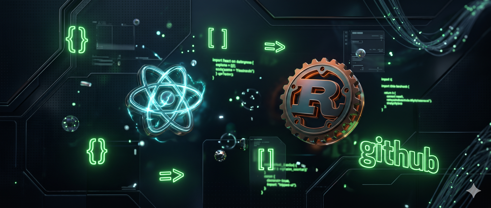

<!-- 1. YOUR CUSTOM 3D BANNER -->
<!-- 1. YOUR CUSTOM 3D BANNER -->

  

 

<!-- 2. LIVE TYPING ANIMATION -->

  

<!-- 3. ANIMATED SOCIAL & PROJECT BADGES -->

  
  

 

<!-- 4. LIVE 3D TROPHIES -->
<h3 align="center">🏆 Live GitHub Achievements</h3>

  

 

<!-- 5. SLEEK PROJECT GRID (WITH PRAVAHA) -->
<h3 align="center">🚀 What I'm Building</h3>
<table align="center" width="100%" style="border: none;">
  <tr>
    <td width="50%" align="center">
      <h3>🌾 <a href="https://github.com/omr-71/marketmitra-app" style="color: #10B981; text-decoration: none;">MarketMitra</a></h3>
      
AI agricultural intelligence platform. Real-time APMC rates & 3D crop disease diagnosis for farmers.

      <code>React</code> <code>Groq AI</code> <code>Supabase</code>
    </td>
    <td width="50%" align="center">
      <h3>🏪 <a href="#" style="color: #10B981; text-decoration: none;">BhavIQ</a></h3>
      
High-performance desktop POS & store management built for high-frequency offline retail transactions.

      <code>Rust</code> <code>Tauri</code> <code>C</code>
    </td>
  </tr>
  <tr>
    <td colspan="2" align="center" style="padding-top: 20px;">
      <h3>🎓 <a href="#" style="color: #10B981; text-decoration: none;">Pravaha</a></h3>
      
Mobile-first opportunity discovery platform featuring Apple News-style glassmorphic navigation.

      <code>React</code> <code>TypeScript</code> <code>Firebase</code>
    </td>
  </tr>
</table>

 

<!-- 6. TECH STACK WITH ANIMATED ICONS -->
<h3 align="center">⚡ Tech Arsenal</h3>

  

 

<!-- 7. DYNAMIC LIVE STATS CARDS -->
<h3 align="center">📈 Real-Time Dev Stats</h3>

  
  

   
  

 

<!-- 8. PROFILE VIEWS TRACKER -->

  

